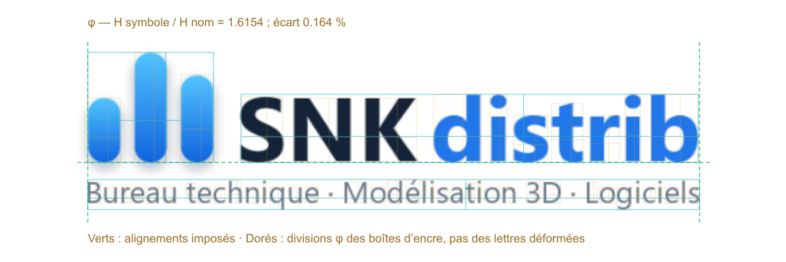

# Nombre d'or et mises en page pour Codex

[English](README.md) · [Contribuer](CONTRIBUTING.md) · [Licence MIT](LICENSE)

Un skill communautaire pour composer des visuels avec des **relations dorées
mesurables**, des marges confortables et des commandes équilibrées.
Écrire « nombre d'or » dans un prompt ne suffit pas : il faut calculer,
implémenter, rendre, mesurer puis inspecter le résultat.

**Projet en développement. Les contributions sont bienvenues.** Une validation
locale ne prouve ni la conformité de toute l'image ni sa beauté.

## Exemple de référence retenu

**PNG propre, fond transparent**


**Filigrane de contrôle** — alignements, boîtes d'encre et subdivisions phi



Bord gauche symbole/slogan : **67 px**. Bas symbole/nom : **124 px**.
Bloc supérieur : **466 px**, dans les **467 px** du slogan.
Le rapport de hauteurs conçu est **84/52 = 1,61538**, soit **0,164 %** d'écart à phi.
Le filigrane ne prétend pas que chaque lettre est un rectangle d'or.
Les deux PNG sont transparents ; le lettrage sombre est prévu sur un support clair.
Voir les [mesures, le contrat et les limites](skills/golden-ratio-visual-design/references/logo-lockup-example.md).

## Contenu

- Instructions compatibles avec Codex et sélection automatique selon la demande.
- Calculateur de partage doré, sans dépendance Python supplémentaire.
- Vérificateur des alignements, proportions, espacements et zones vides.
- Helper facultatif de mesure du DOM d'une interface rendue.
- Tests, définition mathématique et limites explicites des contrôles.

Les boutons ne doivent pas être grossis artificiellement pour fabriquer φ.
L'ergonomie, la lisibilité et les demandes explicites restent prioritaires.

### Version 0.1.2 : logo composé et export bloquant

Le profil `logo-lockup` contrôle ensemble le symbole, le nom et la signature :
alignements centre/bas et centre/gauche explicites, largeur plafonnée par le slogan
si demandée, espacements, marges et centrage facultatif sur le canevas. Il refuse
d'ignorer un élément observé supplémentaire. `export_verified.py` ne crée le
fichier de livraison qu'après validation ; échec ou preuve manquante bloque cet
export. Cette commande est une étape explicite, pas un hook global de génération.
Voir les [instructions de logo et d'export](skills/golden-ratio-visual-design/references/verification.md#three-part-brand-lockups).

### Ajout de la version 0.1.1 : centrage du glyphe visible

Le vérificateur contrôle désormais le centre de l'encre du caractère sur **les deux
axes**, à l'intérieur d'un badge. Une mesure manquante reste NON VÉRIFIÉE ; un écart
hors tolérance échoue. Le profil ciblé `glyph-centering` ne prétend pas valider
toute la composition. Un code de sortie non nul doit bloquer la livraison.
Une retouche conserve explicitement les couleurs et la transparence d'origine.
Voir le [contrat de centrage](skills/golden-ratio-visual-design/references/verification.md#isolated-glyph-centering-repairs).

## Installation

Télécharger `golden-ratio-visual-design.zip` depuis la
[dernière version](https://github.com/SNKdistrib/codex-golden-ratio-skill/releases/latest).
Extraire le dossier `golden-ratio-visual-design` dans `~/.agents/skills/`, soit
normalement `%USERPROFILE%\.agents\skills\` sous Windows.
Sauvegarder toute version existante avant de la remplacer.

Autre possibilité : cloner le dépôt et copier le dossier
`skills/golden-ratio-visual-design` dans le répertoire de skills utilisateur.
Le paquet ne modifie pas automatiquement les préférences globales.

Invocation explicite :

```text
$golden-ratio-visual-design
Compose ce menu avec des marges confortables, puis vérifie la géométrie rendue.
```

La sélection implicite dépend de la description. Une règle personnelle `AGENTS.md`
peut demander son utilisation pour tous les travaux visuels. Si la découverte
n'est pas actualisée, redémarrer Codex.

## Vérifier

Python 3.11+ suffit. Depuis la racine du dépôt :

```sh
python -m unittest discover -s skills/golden-ratio-visual-design/tests -v
python skills/golden-ratio-visual-design/scripts/verify_layout.py --spec contrat.json --measurements mesures.json --image rendu.png --out rapport.json
```

Consulter le [format des mesures](skills/golden-ratio-visual-design/references/verification.md)
avant de préparer les fichiers. Les instructions techniques du paquet sont en anglais.
Les mesures doivent venir du rendu, pas des valeurs demandées au générateur.

Codes de sortie : `0`, les règles déclarées passent ; `1`, au moins un échec ;
`2`, données non vérifiées ou invalides. Le rapport laisse explicitement
`global_composition_conformity: NOT_ESTABLISHED`.

Il n'y a pas d'OCR automatique, de garantie de beauté, d'authentification des
annotations manuelles ou d'audit complet d'accessibilité. Inspecter aussi l'image.

## Participer

Faire un fork, modifier sa copie, exécuter les tests et ouvrir une pull request.
Les mainteneurs vérifient les propositions avant fusion. Les issues permettent
de signaler un problème ou proposer une amélioration.
Voir le [guide de contribution](CONTRIBUTING.md).

Aucune capture personnelle, image de jeu, donnée de compte ou autre skill n'est
publié. Les inspirations sont créditées dans les
[notes de sources](skills/golden-ratio-visual-design/references/sources.md).
